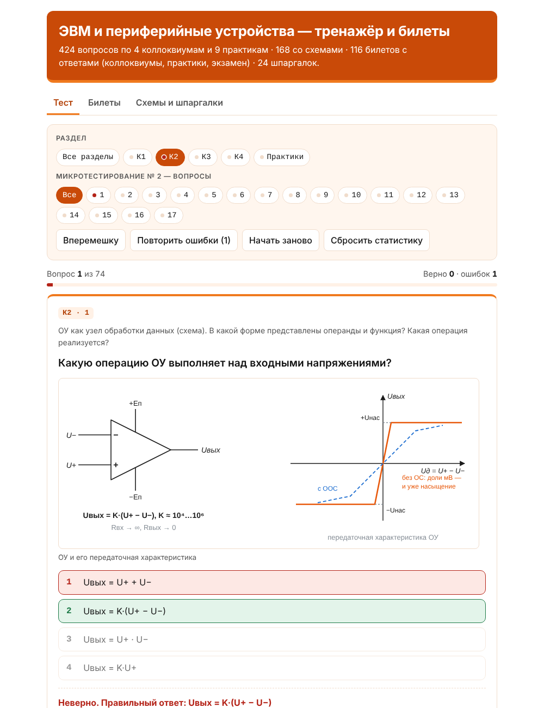

# ЭВМ и ПУ: тренажёр и билеты

Тренажёр к коллоквиумам и экзамену по «ЭВМ и периферийным устройствам» (Середкин В.Г.). Около 420 вопросов по четырём коллоквиумам и девяти практикам и больше сотни билетов с ответами: все вопросы коллоквиумов, 30 экзаменационных и все практики. Картинки — слайды лекций, рисунки из методичек, схемы из отчётов и нарисованные схемы.

Сайт: https://ktoblyachtoblyayablya.github.io/evm-pu-trainer/



## Что внутри

- Тест по разделам: К1 (экспресс-коллоквиум), К2–К4 (микротестирования), практики 1–9. После ответа показываются пояснение, схема и шпаргалка.
- Билеты по спискам вопросов преподавателя. Экзаменационные ссылаются на подробные ответы из коллоквиумов. Есть кнопка «Билет из двух вопросов».
- Все билеты одной страницей (`#all`) и версия для печати (`#print`).
- Повтор ошибок, светлая и тёмная тема. Прогресс хранится в браузере, сервер не нужен.

## Запуск

Открыть `index.html` в браузере или поднять сервер: `python3 -m http.server 8000`.

## Как добавить вопрос

Вопросы лежат в `data/questions/*.js` (k1–k4, pr), билеты — в `data/answers/*.js`, шпаргалки — в `data/cards.js`. Один вопрос — один объект:

```js
{t:"k2-8", q:"Сколько разных номиналов резисторов в матрице R-2R?",
 o:["2","n","2ⁿ","1"],
 e:"Только R и 2R — поэтому матрица технологична.",
 f:"sv_r2r", fb:1, c:"dac"}
```

`t` — тема, `q` — вопрос, `o` — варианты (первый правильный, на странице они перемешиваются), `e` — пояснение. Необязательные поля: `f` — картинка, `fb: 1` — показать картинку сразу, `c` — шпаргалка.

После правок запустите `node tools/validate.js` (нужен Node.js 18+). Та же проверка идёт в GitHub Actions при каждом пуше.

## Слайды и рисунки

В `img/slides` лежат слайды лекций (`L*`), рисунки из методичек (`T_*`) и схемы из отчётов по практикам (`P*`). Права на лекции и методички у авторов, под GPL они не попадают. Схемы в `img/svg` нарисованы для проекта, исходники — в `tools/draw_src/`.

## Лицензия

Copyright (C) 2026 Пантелеев Г.Д. Код, вопросы, билеты и схемы `img/svg` распространяются под [GPL-3.0-or-later](LICENSE).
